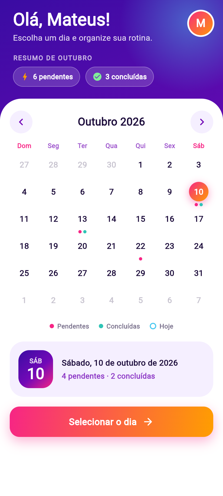
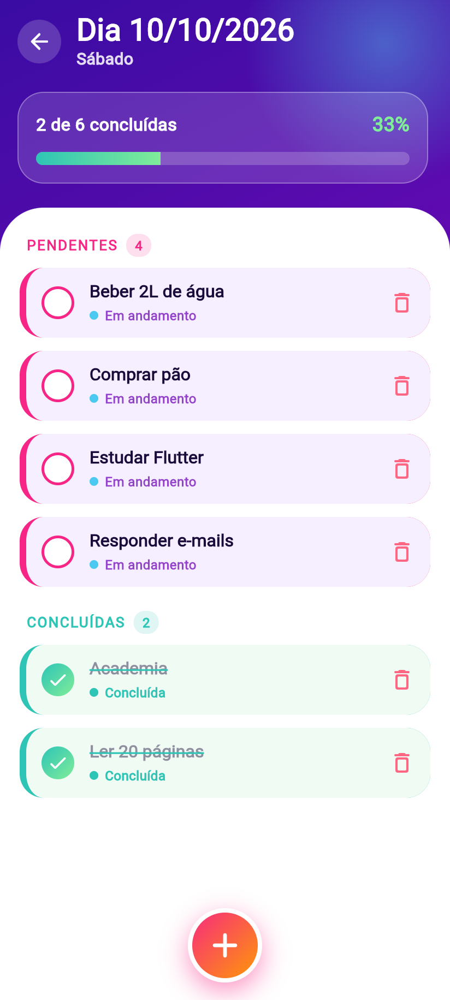

# Agenda Neon 📅✨

Aplicativo Flutter de tarefas diárias, com **cadastro/login**, **calendário** e **lista de tarefas por dia**.

| Login / Cadastro | Calendário | Tarefas |
|---|---|---|
|  |  |  |

## Funcionalidades
- Cadastro e login locais (sem Firebase), com validação e senha salva como hash SHA-256
- Sessão lembrada: quem já entrou cai direto no calendário
- Calendário mensal próprio (sem pacote externo), com marcadores de tarefas pendentes/concluídas
- Lista de tarefas do dia: **pendentes primeiro, depois concluídas, ambas em ordem alfabética** (ignora maiúsculas e acentos)
- Adicionar tarefa via `showDialog` (toda tarefa nova começa como não concluída)
- Marcar/desmarcar como concluída (com barra de progresso)
- Remover pela lixeira ou arrastando para o lado, com botão **Desfazer**
- Dados salvos no aparelho com `shared_preferences`

## Estrutura
```
lib/
├── main.dart                 # MaterialApp + tema
├── models/                   # Task, AppUser
├── services/                 # AuthService (login/cadastro), TaskRepository (ChangeNotifier)
├── screens/                  # splash_gate, auth_screen, calendar_screen, tasks_screen
├── widgets/                  # neon_calendar, task_tile, add_task_dialog, gradient_button...
├── theme/app_theme.dart      # paleta "Neon Sunset"
└── utils/date_utils_br.dart  # datas em português e ordenação sem acentos
test/                         # testes de unidade e do fluxo completo do app
```

## Como rodar
```bash
flutter pub get
flutter run            # Android (emulador)
flutter run -d chrome  # navegador
flutter test           # roda os 11 testes
```
